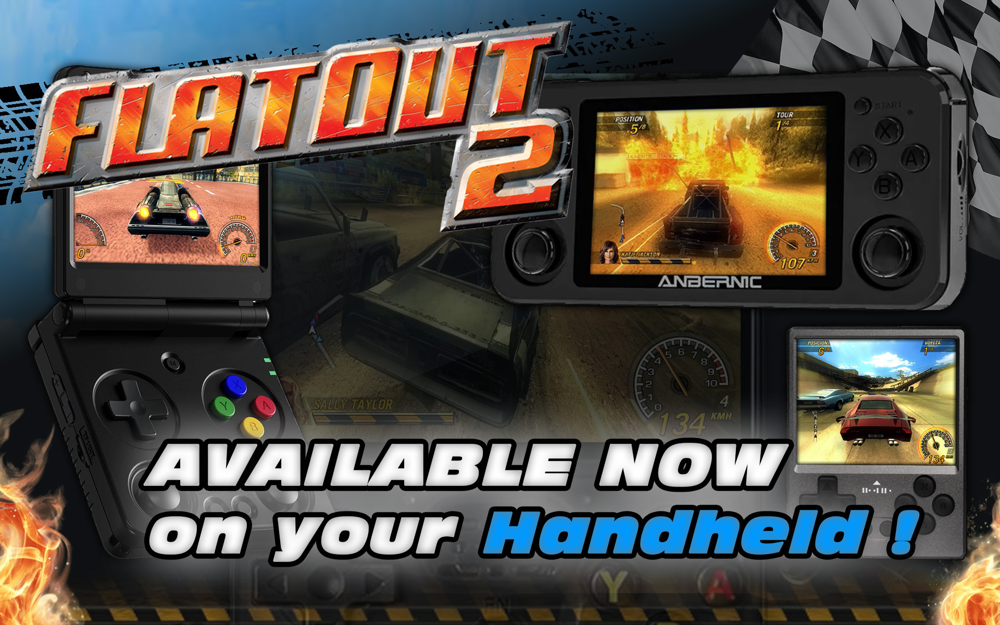
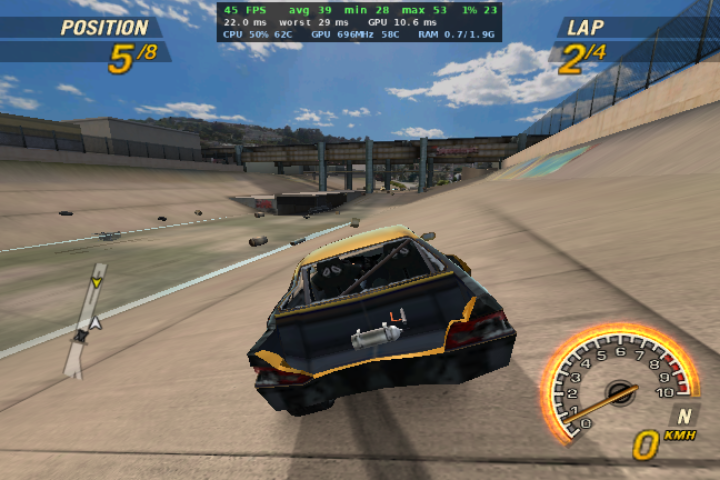
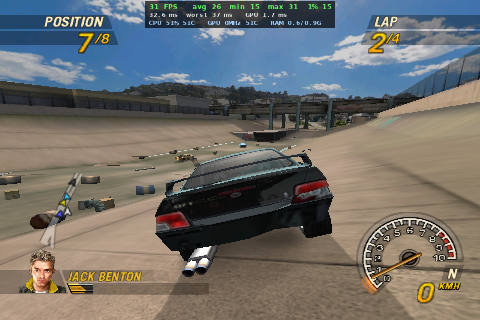
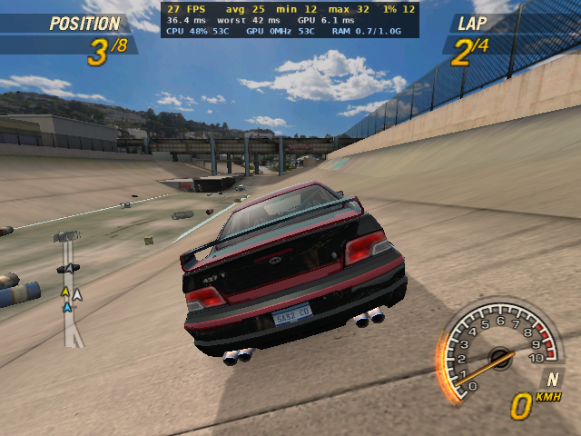

# FlatOut 2 for ARM64 handhelds

FlatOut 2 (PC) statically recompiled to native ARM64 Linux, as a PortMaster-style port. You provide the game files, the port does the rest: nothing to compile.

**Transparency:** this port was developed entirely with Claude, Anthropic's AI, which wrote the code. My own part was testing it on real consoles, analysing the results and proposing improvements.

> **New in 2.1.0:** the port accepts other releases of the game (GOG, Steam, retail patch 1.2), see [What you need](#what-you-need). **New in 2.0.0:** [LAN multiplayer](#lan-multiplayer) between consoles and with a Windows PC, and native gamepad support with **analog steering** (progressive d-pad steering on consoles without a stick). [Download it from the Releases](https://github.com/badcats72/flatout2-portmaster/releases/latest).

<!-- SCREENSHOTS: one per console, same place in the game, FPS counter visible -->

| RG34XX-SP | RG351P | GKD Pixel II |
|---|---|---|
|  |  |  |

Click an image to see it at its real resolution.

## Tested consoles

| Console | Chip | CPU | GPU | OS | Render size | Average FPS | Min | 1% low |
|---|---|---|---|---|---|---|---|---|
| Anbernic RG34XX-SP (2 GB) | H700 | Cortex-A53 | Mali-G31 MP2 | Knulli Scarab | 648x432 | 52 | 40 | 20 |
| Anbernic RG351P | RK3326 | Cortex-A35 | Mali-G31 MP2 | dArkOS | 480x320 | 33 | 20 | 18 |
| GKD Pixel II | RK3326S | Cortex-A35 | Mali-G31 2EE | ROCKNIX | 640x480 | 36 | 23 | 17 |

Measured with the port's own FPS counter by playing one lap on the same track with the same car, in similar driving, with busy moments and quiet ones. These are the figures shown on the screenshots above (taken with 1.1.0; 2.0.0 runs at the same speed): expect some variation between races.

### Version 1.0.0 against 1.1.0 and 2.0.0

Same track, same car, one lap each time. Version 2.0.0 adds LAN multiplayer and the gamepad on top of 1.1.0, with the same performance.

| Console | Average FPS | Min | 1% low |
|---|---|---|---|
| RG34XX-SP | 39 → 52 | 28 → 40 | 23 → 20 |
| RG351P | 26 → 33 | 15 → 20 | 15 → 18 |
| GKD Pixel II | 25 → 36 | 12 → 23 | 12 → 17 |

Version 1.0.0 was limited to 30 FPS on the RG351P and the GKD Pixel II; versions 1.1.0 and 2.0.0 are not. The two RG351P runs were made on two consoles of the same model.

| | RG34XX-SP | RG351P | GKD Pixel II |
|---|---|---|---|
| 1.0.0 |  |  |  |
| 1.1.0 / 2.0.0 |  |  |  |

**R36S (dArkOSen):** reported working by a user with the community fix of [Coreilabs](https://github.com/coreilabs/flatout2-fix-r36s-darkosEN), now built into the launcher (KMSDRM video, ALSA sound, 640x480, the text console released while the game runs). Not tested by me.

Other consoles are not tested. The launcher tries to adapt to the screen and video driver of an unknown console, but it may need work: please open an issue with your console, your OS and `ports/flatout2/log.txt`.

## What you need

You must own the game. This port does not contain any of its data.

The port was made and tested with the **Zoom Platform** version of the game (v2.1.0.9; the Steam version was updated to match it in 2024), whose `FlatOut2.exe` has this MD5: `1f8cae2b47276ca134750ba438aa35ca`.

**Other versions** (GOG, Steam, retail with patch 1.2) are accepted when their `FlatOut2.exe` is the same 1.2 build: the port compares it with the tested one, and shows a notice in the game for its first seconds. If you meet a bug with such a version, please [open an issue](https://github.com/badcats72/flatout2-portmaster/issues) with `ports/flatout2/log.txt`. An executable from another build, or packed / encrypted by a DRM (the retail CDs' SecuROM or StarForce), is refused with a message.

The game also needs `d3dx9_30.dll` in its folder. If your release does not have it, copy it from a Windows PC: `C:\Windows\SysWOW64\d3dx9_30.dll`.

## Install

1. Copy the launcher `FlatOut 2.sh` and the `flatout2` folder from the release zip into your `ports` folder.
2. Copy everything from your game's folder into `ports/flatout2/gamedata/`. About 3 GB are needed. A folder copied inside `gamedata/` (the game's folder itself, or a GOG installer's `app` folder) is found too: its content is moved up at the first launch.
3. Start `FlatOut 2` from the Ports menu.

The first race after an install or an update can stutter for a moment: the port is filling its shader cache. It does not come back afterwards.

### Updating from 1.1.0

Replace `ports/flatout2/fo2.aarch64` and `FlatOut 2.sh` with the new ones, and copy the new `ports/flatout2/pad` folder. Your game files and your saves stay as they are. The launcher switches the game to its gamepad controls by itself.

### Updating from 1.0.0

Do the same, then delete the two old launchers (`FlatOut 2 [RK3326 - 30 FPS].sh` and `FlatOut 2 [H700 - FPS Unlock].sh`).

## Controls

The console is seen by the game as an Xbox gamepad: **steering is analog** on the left stick. On consoles without a stick, the d-pad steers progressively, like a stick pushed by the thumb. A small dead zone ignores a stick that drifts at rest.

| Button | In a race |
|---|---|
| Left stick / d-pad | Steer |
| South button | Accelerate, confirm |
| West button | Brake, reverse |
| East button | Handbrake, back |
| North button | Reset the car |
| R1 | Nitro |
| R2 / L2 | Shift up / down |
| Select | Change camera |
| Start | Pause |

The game's own Options > Controls menu can remap the controls and set the steering's dead zone, saturation and sensitivity. Your changes are kept.

| Combination | Action |
|---|---|
| **Select + L1** | Swaps A/B and X/Y, remembered. Use it once if your buttons are the wrong way round |
| **L2 + R2** | Shows or hides the FPS counter, which counts from that moment |
| **L1 + R2** | Screenshot, saved as `ports/flatout2/screenshot_N.ppm` |
| **Select + Start** | Quit |

## LAN multiplayer

Up to 8 players over the same Wi-Fi network: in the game, choose Multiplayer, then LAN. One console creates the game, the others join it. Tested with four consoles (RG34XX-SP, GKD Pixel II, two RG351P) and a Windows PC running the GOG / Zoom version, which can host or join.

- The launcher turns off the Wi-Fi's power saving while the game runs (it delayed packets long enough to drop players), and puts it back on exit.
- **On a Windows PC:** the network must be set as private, and VPN adapters such as Radmin VPN can take the game's traffic away from your Wi-Fi: quit them before playing.
- **RG351P on dArkOS:** turn on zram (swap) in the system's options, or the console can run out of memory when a LAN race starts.
- The game uses UDP ports 23756 and 23757.

## What this port adds

- A 100% save in profile slot 8, named **TEST**: every car and every event unlocked, to try the whole game at once.
- A fourth chase camera, close to the car.
- Native FMV decoding through the console's FFmpeg (no FFmpeg, no videos).
- Sparks and particles filtered to hide a rendering glitch.

## Known problems

- Online play is not available (LAN only).
- On weak Wi-Fi, a console can lose its connection during a LAN race.
- Small graphical glitches can appear with the sparks when cars touch.
- On RK3326 consoles, big crashes can still drop the frame rate for a moment.
- Short silences can remain in the music during loading screens.

## Roadmap

- **Graphics:** fix the spark glitches.
- **Performance:** the heaviest moments on small chips.
- More consoles and screen formats (16:9), with your reports.
- A way to change the game's language.

## Version

Current version: **2.1.0**. See the [Releases](https://github.com/badcats72/flatout2-portmaster/releases) for what changed.

## Advanced settings

Optional file `ports/flatout2/fo2.env`, one `VARIABLE=value` per line:

| Variable | Effect |
|---|---|
| `FO2_CAP=30` | Frame rate limit (60 by default). 30 gives a steadier picture on small chips |
| `FO2_RENDER=640x480` | Render size |
| `FO2_SWAP_ABXY=1` | Start with A/B and X/Y swapped |
| `FO2_KEEP_SETTINGS=1` | Keep the game's own graphics settings (the launcher otherwise forces the lowest) |
| `NFSU2_SHOW_FPS=1` | FPS counter on at launch |
| `FO2_STICK_DEADZONE=15` | Stick dead zone in percent (15 by default). Raise it if your stick drifts |
| `FO2_DPAD_RAMP_MS=150` | Time for the d-pad to reach full steering, in milliseconds (0: at once) |
| `FO2_DIRECTINPUT_PAD=0` | Keyboard controls of 1.x (digital steering) instead of the gamepad |
| `FO2_LAN=0` | LAN off |
| `FO2_WIFI_AWAKE=0` | Leave the Wi-Fi's power saving on during LAN games |
| `FO2_ANY_EXE=1` | Try a `FlatOut2.exe` that the port refuses (for testing only: it will most likely crash) |
| `NFSU2_PARALLEL_THREADS=` | Empty: the sound engine's threads take turns with the game again, as in 1.0.0. Only for diagnosing a sound problem |

## Source code

The code of the port is in this repository, under the MIT license (see `LICENSE`). To change it and rebuild it, see [BUILD.md](BUILD.md). The repository itself holds no game files or generated code; the binary in the Release is built from the game's executable.

## Credits

Bugbear Entertainment and Empire Interactive made the game. The R36S launcher profile comes from the community fix by [Coreilabs](https://github.com/coreilabs/flatout2-fix-r36s-darkosEN) (MIT). The recompilation runtime comes from the [NFSU2 recompiled port](https://github.com/manuelpllull/nfsu2-recompiled-r36s) (MIT), built with [pcrecomp](https://github.com/sp00nznet/pcrecomp) (MIT), with MojoShader (zlib) and stb (public domain or MIT). FFmpeg is the console's own. See `THIRD_PARTY_NOTICES.md`.

This project is not affiliated with or endorsed by the game's rights holders. FlatOut is a trademark of its respective owner.
